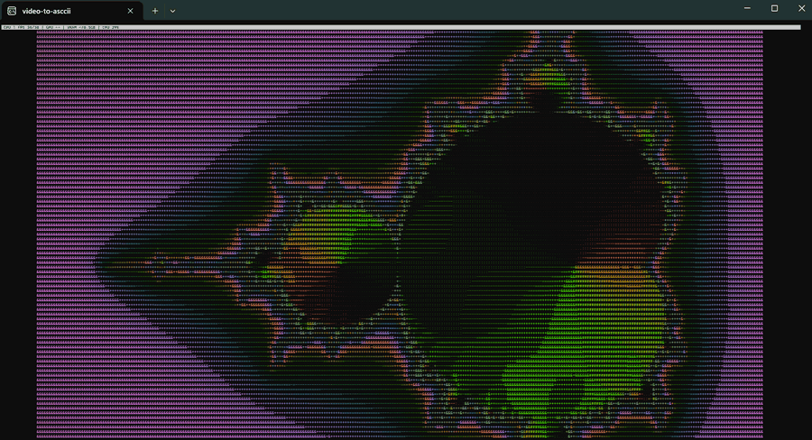
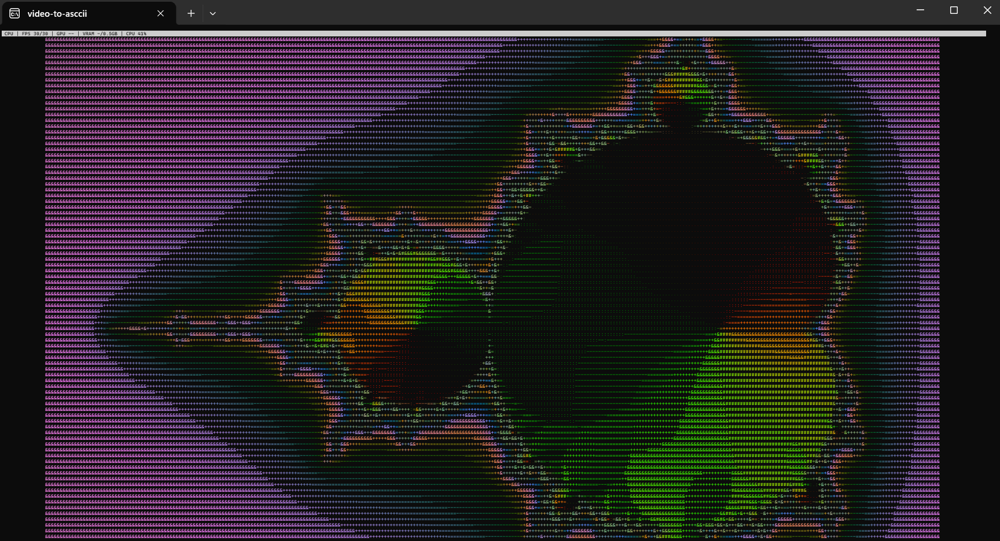
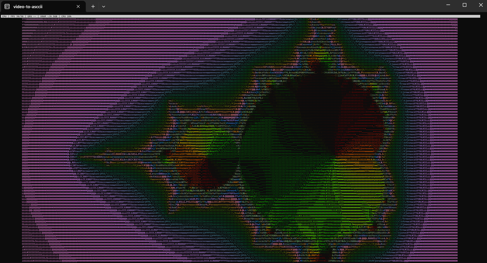
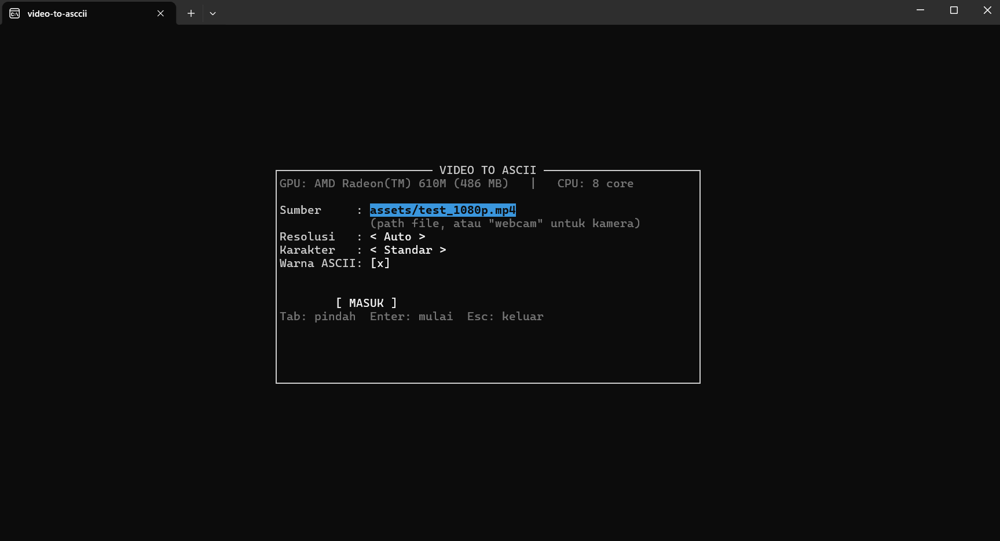
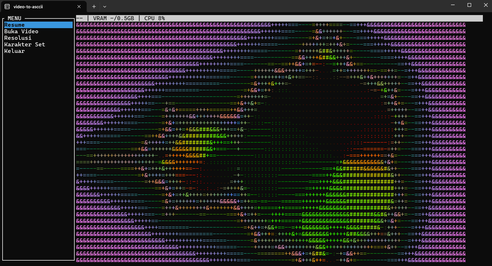
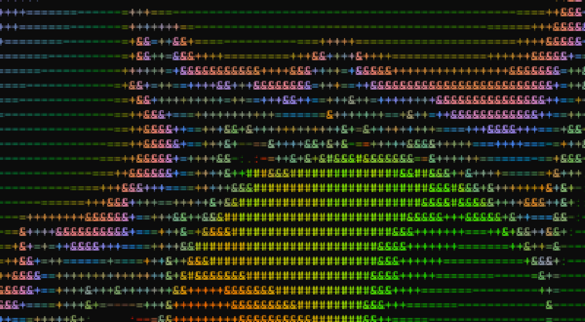

# video-to-asccii

Putar video sebagai **ASCII art berwarna** langsung di terminal. Ditulis dengan **Rust**,
cepat (video 1080p tetap mulus di atas 30 FPS), dan bisa juga memakai **webcam** secara real-time.

<p align="center">
  
</p>

<p align="center"><sub>Rekaman layar asli di Windows Terminal. Font terminal diperkecil (<code>Ctrl</code> + <code>-</code>)
supaya muat ±340 kolom karakter, dan video tetap berjalan ~30 FPS. Lihat <a href="#screenshot">close-up</a> di bawah:
setiap titik adalah karakter ASCII berwarna.</sub></p>

---

## Fitur

- **Video → ASCII truecolor** (mp4, mkv, mov, avi, webm), memenuhi seluruh terminal.
- **Webcam real-time** (Windows).
- **Layar startup + menu**: pilih video, resolusi, set karakter, dan warna on/off tanpa hafal perintah.
- **Stats bar**: FPS, backend (CPU/GPU), pemakaian CPU, nama GPU + VRAM.
- **Video otomatis diulang** (loop) tanpa patah.
- **4 set karakter**: Standar, Blok, Detil, dan Ultra (70 tingkat kecerahan).
- **Engine GPU opsional** (`--gpu`), dengan fallback otomatis ke CPU.

---

## Screenshot

| Sedang diputar: set karakter Standar (±340 kolom) | Set karakter Ultra, 70 tingkat (±340 kolom) |
|---|---|
|  |  |
| **Layar startup** | **Menu (video dijeda)** |
|  |  |

**Close-up**: potongan screenshot resolusi tinggi di atas, diperbesar tanpa dihaluskan. Setiap "piksel" sebenarnya
adalah satu karakter ASCII dengan warnanya sendiri.



<sub>Semua gambar adalah screenshot asli dari Windows Terminal (Windows 11, laptop 1920×1080, AMD Radeon 610M).
Screenshot video diambil dengan font diperkecil 7× lewat <code>Ctrl</code> + <code>-</code> (±340×88 sel); layar
startup dan menu memakai font normal (170×44 sel). Video sampel Mandelbrot dibuat dengan ffmpeg, jadi kamu bisa
mencobanya sendiri:</sub>

```bash
ffmpeg -f lavfi -i "mandelbrot=size=1280x720:rate=30:maxiter=2048:outer=normalized_iteration_count:start_scale=2.5:end_scale=0.9:end_pts=600" -t 20 -pix_fmt yuv420p mandelbrot.mp4
cargo run --release -- mandelbrot.mp4 --play
```

---

## Kebutuhan

| Komponen | Keterangan |
|---|---|
| Sistem operasi | **Windows 10/11** (dikembangkan & diuji di sini). Linux/macOS belum diuji. |
| Rust | Versi stable terbaru (lewat [rustup](https://rustup.rs)). |
| ffmpeg + ffprobe | Wajib ada di `PATH`. Dipakai untuk membaca video dan webcam. |
| Terminal | Yang mendukung truecolor. Disarankan **Windows Terminal**. |

---

## Instalasi

### 1. Install Rust

Unduh installer dari <https://rustup.rs>, jalankan, lalu ikuti petunjuknya.
Setelah selesai, buka terminal baru dan cek:

```bash
cargo --version
```

### 2. Install ffmpeg

Pilih salah satu cara (Windows):

```powershell
winget install Gyan.FFmpeg
```

```powershell
scoop install ffmpeg
```

```powershell
choco install ffmpeg
```

**Tutup lalu buka lagi terminal** supaya `PATH` ter-update, kemudian cek:

```bash
ffmpeg -version
```

### 3. Clone & build

```bash
git clone https://github.com/dosigprg-creator/video-to-asccii.git
cd video-to-asccii
cargo build --release
```

Build pertama butuh beberapa menit karena Cargo mengunduh dan meng-compile semua dependency.
Hasilnya ada di `target/release/video_to_ascii.exe`.

---

## Mulai Cepat

```bash
cargo run --release
```

Layar startup akan muncul dengan video uji bawaan (`assets/test_1080p.mp4`) yang sudah terisi.
Tekan **Enter** untuk mulai, **q** untuk membuka menu, **Esc** untuk keluar.

> **Selalu pakai `--release`.** Build debug jauh lebih lambat dan gambarnya akan patah-patah.

---

## Cara Pakai

### Putar video sendiri

```bash
cargo run --release -- "D:\Video\film saya.mp4" --play
```

- Tanda `--` memisahkan argumen untuk Cargo dan argumen untuk program.
- Pakai **tanda kutip** bila path mengandung spasi.
- Tanpa `--play`, program membuka layar startup dulu dan path bisa diubah di sana.

Bisa juga menjalankan hasil build secara langsung (lebih cepat, tanpa cek ulang oleh Cargo):

```powershell
.\target\release\video_to_ascii.exe "D:\Video\film saya.mp4" --play
```

### Pakai webcam

```bash
# lihat daftar kamera yang terdeteksi
cargo run --release -- --list-cams

# pakai kamera pertama
cargo run --release -- --webcam

# pakai kamera tertentu (nama persis dari --list-cams)
cargo run --release -- --webcam "Integrated Camera"
```

Saat memilih kamera otomatis, kamera virtual (OBS, NDI, EOS Webcam, dan sejenisnya) dilewati
selama ada kamera fisik. Di layar startup, kamu juga bisa mengetik `webcam` atau
`webcam:Nama Kamera` di kolom **Sumber**.

### Install sebagai perintah global (opsional)

```bash
cargo install --git https://github.com/dosigprg-creator/video-to-asccii.git
video_to_ascii "D:\Video\film saya.mp4" --play
```

Dengan cara ini video uji bawaan tidak ikut terpasang, jadi selalu sebutkan path video
(atau pakai `--webcam`).

---

## Kontrol Keyboard

**Layar startup**

| Tombol | Fungsi |
|---|---|
| `Tab` / `↓` | Pindah ke kolom berikutnya |
| `Shift+Tab` / `↑` | Pindah ke kolom sebelumnya |
| Ketik / `Backspace` | Isi path video (saat kolom **Sumber** aktif) |
| `←` `→` | Ganti **Resolusi**, **Karakter**, atau **Warna ASCII** on/off |
| `Spasi` | Nyalakan/matikan warna (saat kolom **Warna ASCII** aktif) |
| `Enter` | Mulai memutar |
| `Esc` | Keluar |

**Saat video diputar**

| Tombol | Fungsi |
|---|---|
| `q` | Buka menu (video dijeda) |
| `Esc` | Keluar |

**Menu**

| Tombol | Fungsi |
|---|---|
| `↑` `↓` | Pilih item |
| `Enter` | Jalankan item |
| `q` | Tutup menu, lanjut memutar |
| `Esc` | Keluar |

Item menu: **Resume** · **Buka Video** (kembali ke layar startup) · **Resolusi** dan
**Karakter Set** (berganti setiap kali `Enter`) · **Keluar**.

---

## Semua Opsi CLI

```text
video_to_ascii [PATH] [OPSI]
```

| Opsi | Fungsi |
|---|---|
| `PATH` | Path video. Default: `assets/test_1080p.mp4`. Bisa juga `webcam` atau `webcam:Nama`. |
| `--play` | Langsung putar, lewati layar startup. |
| `--webcam [NAMA]` | Pakai webcam. Tanpa nama = kamera fisik pertama. |
| `--list-cams` | Tampilkan daftar webcam lalu keluar. |
| `--cols N` | Batasi lebar output (dalam kolom) untuk mode `--stdout`. Default 100. |
| `--gpu` | Pakai engine GPU (wgpu). Otomatis kembali ke CPU bila gagal. |
| `--hwinfo` | Tampilkan info CPU, GPU, dan VRAM lalu keluar. |
| `--stdout` | Cetak frame ASCII ke stdout (tanpa UI) lalu keluar. |
| `--frames N` | Jumlah frame yang dicetak di mode `--stdout`. Default 1. |
| `--bench-fps DETIK` | Ukur FPS pipeline (tanpa UI) selama N detik. |
| `--bench-gpu` | Bandingkan kecepatan engine CPU vs GPU. |
| `--bench-cols N` / `--bench-rows N` | Ukuran layar virtual untuk mode benchmark. Default 200×55. |
| `-h`, `--help` | Tampilkan bantuan. |

Contoh mode `--stdout`, berguna untuk mencoba tanpa membuka UI:

```bash
cargo run --release -- --stdout --frames 1 --cols 80
```

---

## Tips Supaya Hasilnya Bagus

- **Jadikan terminal fullscreen** (`F11` di Windows Terminal) supaya gambarnya lebih besar.
- **Ingin lebih detail? Kecilkan font terminal** (`Ctrl` + `-`, kembalikan dengan `Ctrl` + `0`).
  Satu karakter = satu sel terminal, jadi jumlah kolom ditentukan oleh ukuran font, bukan oleh program.
  Dengan resolusi **Auto**, gambar langsung menyesuaikan saat font diubah.
- **Patokan dari hasil uji** (laptop 1920×1080, Windows Terminal, font default): menekan `Ctrl` + `-`
  7 kali memberi ±340 kolom dan tetap ~30 FPS. Di 8 kali, FPS turun ke ~17; di 9 kali, terminal
  tidak sanggup menggambar ulang dan gambar mulai robek. Batasnya ada di kecepatan terminal, bukan engine.
- **Coba set karakter lain** dari menu. Ultra punya gradasi paling halus (70 tingkat).
- **Patah-patah di resolusi tinggi?** Biasanya yang jadi batas adalah kecepatan terminal, bukan
  engine. Turunkan resolusi atau perbesar sedikit font.

---

## Troubleshooting

| Masalah | Solusi |
|---|---|
| `gagal spawn ffmpeg (pastikan ffmpeg ada di PATH)` | ffmpeg belum terpasang atau belum masuk `PATH`. Install ffmpeg, buka ulang terminal, lalu cek `ffmpeg -version`. |
| `Gagal buka sumber: ...` di layar startup | Periksa path video. Path relatif dihitung dari folder tempat perintah dijalankan; path dengan spasi wajib pakai tanda kutip. |
| Webcam tidak terdeteksi atau layar diam | Jalankan `--list-cams`, tutup aplikasi lain yang sedang memakai kamera, lalu pakai nama kamera persis dari daftar. |
| Semua tampil hitam-putih (termasuk stats bar) | Variabel lingkungan `NO_COLOR` sedang aktif, dan library terminal yang dipakai mematuhinya. Cek dengan `echo $env:NO_COLOR` (PowerShell); matikan untuk sesi itu dengan `Remove-Item Env:NO_COLOR`. |
| Warna tampak aneh | Pakai terminal yang mendukung truecolor, misalnya Windows Terminal. |
| Gambar patah-patah | Pastikan memakai `--release`, lalu turunkan resolusi lewat menu. |

---

## Cara Kerja Singkat

```text
┌─────────────┐     ┌──────────────┐     ┌──────────────┐
│   SOURCE    │ --> │    ENGINE    │ --> │   RENDERER   │
│ (frame RGB) │     │ (frame→ASCII)│     │ (ASCII→layar)│
└─────────────┘     └──────────────┘     └──────────────┘
  video / webcam      CPU (rayon+SIMD)      ratatui
  (ffmpeg pipe)       atau GPU (wgpu)        (cell-diff)
```

1. **Source** membaca frame RGB mentah dari subprocess `ffmpeg` (file video maupun webcam).
2. **Engine** mengecilkan frame, menghitung kecerahan, memilih karakter, dan mengelompokkan
   warna. Di CPU, pekerjaan ini dibagi ke semua core (`rayon`) dengan resize SIMD.
3. **Renderer** menulis hasilnya ke layar lewat `ratatui`, dan hanya sel yang berubah yang
   dikirim ke terminal.

Decode berjalan di thread terpisah. Renderer selalu mengambil frame terbaru dan membuang
frame yang sudah basi, jadi video tidak tertinggal walau terminal sempat lambat.

---

## Performa

Diukur dengan build release dan sumber 1080p. *Engine* = waktu konversi satu frame.

| Output | Engine CPU | Pipeline (tanpa UI) |
|---|---|---|
| 200×55 (fullscreen umum) | ~1.1 ms | ~100 FPS |
| 800×225 (detail tinggi) | ~3.8 ms | — |

**Kenapa CPU jadi default, bukan GPU?** Untuk beban ini CPU justru lebih cepat:

| Output | CPU | GPU (Radeon 610M) |
|---|---|---|
| 200×55 | 1.28 ms | 5.99 ms |
| 800×225 | 3.62 ms | 8.31 ms |

Datanya kecil dan bolak-balik setiap frame, sehingga biaya kirim frame ke GPU dan membaca
hasilnya kembali lebih besar daripada komputasinya. Ukur sendiri di mesinmu dengan
`--bench-gpu`.

---

## Pengembangan

```bash
cargo test     # unit + integration test
cargo clippy   # lint
cargo bench    # benchmark engine (criterion)
```

```text
src/
├── main.rs                 # entry point + parsing CLI + mode headless
├── app.rs                  # state machine (Startup/Playing/Menu) + event loop
├── config.rs               # preset resolusi & set karakter
├── pipeline.rs             # decode thread + bounded channel + drop-stale
├── source/                 # sumber frame: video.rs (ffmpeg) · webcam.rs (DirectShow)
├── engine/                 # konversi frame → ASCII: CPU (mod.rs) & GPU (gpu.rs)
├── render/                 # renderer ratatui + cache style
├── ui/                     # startup · menu · mode clean · stats bar
└── hardware/               # deteksi GPU/VRAM/CPU
benches/engine_bench.rs     # benchmark criterion
tests/                      # integration test (TestBackend)
assets/test_1080p.mp4       # video uji (ffmpeg testsrc, 5 detik)
assets/screenshots/         # screenshot & GIF untuk README
```

Video uji dibuat dengan:

```bash
ffmpeg -f lavfi -i testsrc=size=1920x1080:rate=30 -t 5 assets/test_1080p.mp4
```

---

## Lisensi

[MIT](LICENSE) © 2026 dosigprg-creator
